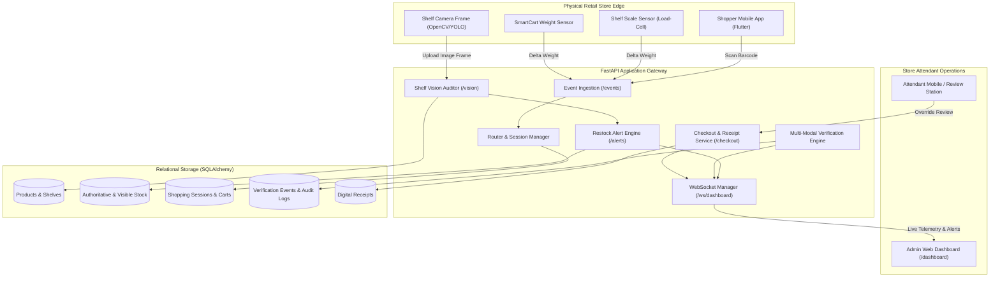
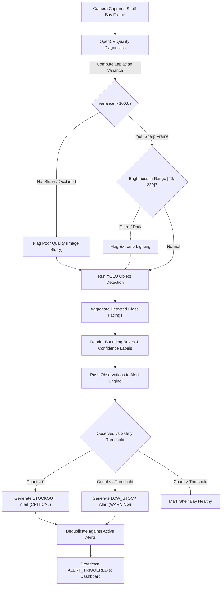
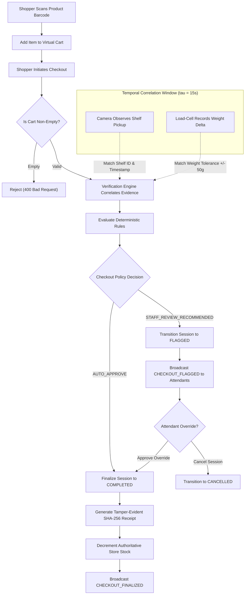
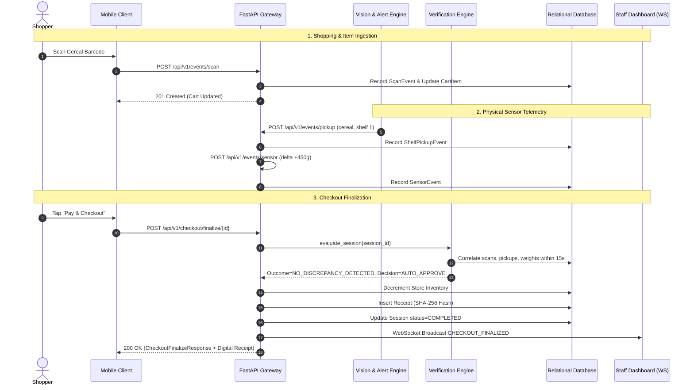
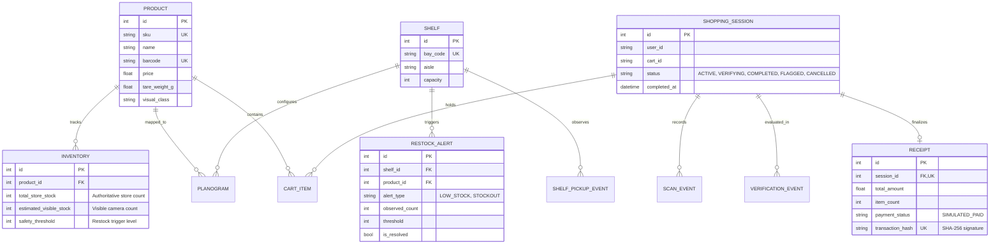

# SmartCart AI

> **Shop Smarter. Verify Instantly. Restock Proactively.**  
> Multimodal Computer Vision, Scan & Go Self-Checkout Verification, and Proactive Shelf Auditing for Next-Generation Retail.

[](https://www.python.org/downloads/)
[](https://fastapi.tiangolo.com)
[](https://opencv.org/)
[](https://flutter.dev/)
[](backend/app/docs/integration_test_report.md)
[](LICENSE)

---

### Hackathon Metadata & Project Identification

| Parameter | Project Record |
| :--- | :--- |
| **Hackathon** | **Computer Vision AI Hackathon 2026** (E-Cell IIT Bombay & Everseen) |
| **Problem Statement** | **Problem Statement 2: Mobile Scan and Go – Checkout Anywhere Loss Prevention** |
| **Project Title** | **SmartCart AI** |
| **Team Name** | **LIFTOFF** (Team Leader: Ashraf Hussain Siddiqui) |
| **Institution** | **Universal SkillTech University (USTU)** |
| **Tagline** | *Shop Smarter. Verify Instantly. Restock Proactively.* |
| **Presentation Deck** | [Google Drive Presentation](https://drive.google.com/file/d/1SlEyEoBIBbtSVJiNsRr_drxD9i10xcfl/view) |

---

## 1. Project Overview

**SmartCart AI** is an enterprise-grade retail intelligence platform that unifies computer vision, mobile Scan & Go self-checkout, automated shelf auditing, and sensor event correlation into a cohesive loss-prevention and inventory optimization ecosystem.

In modern retail environments, self-checkout and mobile Scan & Go systems suffer from a fundamental architectural flaw: **a barcode scan records only a customer's claimed intent to purchase, without automated validation of physical reality.** Meanwhile, store attendants struggle with manual shelf audits, resulting in unobserved stockouts, misplaced SKUs, phantom inventory, and delayed replenishment.

SmartCart AI bridges physical store interactions with digital transactions. By fusing fixed shelf camera frames, spatial planogram matching, and time-synchronized sensor correlation (barcode scans, vision pickup observations, and load-cell weight deltas), the system:
1. **Audits shelf facings** and identifies low-stock and stockout conditions in real time using OpenCV and YOLO models.
2. **Maintains strict separation** between visible front-facing shelf items and authoritative store ledger inventory.
3. **Validates shopper cart interactions** across multiple physical modalities within configurable time windows ($\tau=15\text{s}$) and weight tolerances ($\pm 50\text{g}$).
4. **Decouples checkout decisions** (`AUTO_APPROVE` vs `STAFF_REVIEW_RECOMMENDED`) to ensure customer interactions remain collaborative and friendly rather than accusatory.
5. **Streams real-time alerts and verification decisions** to store attendants via WebSockets and an integrated dark-mode operations dashboard.

---

## 2. Problem Statement and Solution

### The Retail Shrink & Audit Dilemma
- **Friction vs. Loss Prevention**: Conventional anti-theft gates and random manual bag checks alienate honest shoppers, cause queue bottlenecks, and fail to stop covert unscanned item placement.
- **Single-Modality Vulnerability**: Systems relying exclusively on barcode scans cannot detect when a shopper scans a cheap item while placing a premium item into their cart.
- **Inventory Blindness**: Store managers only discover out-of-stock shelves hours after sales drop, because backroom ledger counts do not reflect what is actually accessible to customers on the sales floor.

### The SmartCart AI Solution
- **Multi-Modal Triangulation**: A physical item addition is only verified when corroborated by (1) a client barcode scan, (2) an overhead/shelf camera pickup observation, and (3) a cart/shelf weight scale delta matching the catalogued product tare weight.
- **Missing vs Contradictory Evidence Separation**: Missing sensor data (e.g., an uninstrumented shelf) is marked `INCONCLUSIVE` and handled gracefully, while explicit conflicts (e.g., camera sees 2 boxes, shopper scanned 1) trigger `POTENTIAL_DISCREPANCY`.
- **Friendly Attendant Assistance**: Shoppers with flagged sessions are directed to store staff for assistance rather than accused of wrongdoing. Attendants can review multi-modal evidence on their console and perform a one-click audit override.

---

## 3. Features & Implementation-Status Matrix

| Capability / Module | Implementation Status | Technical Mechanism & Notes |
| :--- | :---: | :---: |
| **Product & Inventory Catalog** | **Implemented** | SQLite/PostgreSQL with SQLAlchemy 2.0; separate `total_store_stock` and `estimated_visible_stock` |
| **Shopping Session & Virtual Cart** | **Implemented** | Transactional cart item management with running spend totals and quantity updates |
| **Multi-Modal Event Ingestion** | **Implemented** | REST endpoints for barcode scans, shelf camera pickups, and load-cell sensor weight deltas |
| **Computer Vision Shelf Auditor** | **Implemented** | OpenCV 5.x decoding, Laplacian blur detection ($\sigma^2$), brightness score, YOLO object detection fallback |
| **Stockout & Low-Stock Alerts** | **Implemented** | Real-time threshold evaluation, automated deduplication, and attendant resolution workflow |
| **Multi-Modal Verification Engine** | **Implemented** | Event correlation with time window $\tau=15\text{s}$, tare tolerance $\pm 50\text{g}$, and idempotent SHA-256 fingerprinting |
| **Decoupled Checkout Decision** | **Implemented** | `AUTO_APPROVE` vs `STAFF_REVIEW_RECOMMENDED` with built-in trust and safety notices |
| **Staff Admin Operations Console** | **Implemented** | Zero-build dark glassmorphic SPA served at `/dashboard` with responsive tabs and KPI metrics |
| **Real-Time WebSocket Gateway** | **Implemented** | Native FastAPI WebSocket `/api/v1/ws/dashboard` with heartbeat ping/pong and push broadcasts |
| **Checkout Finalization & Receipts** | **Implemented** | Atomic transaction finalization, SHA-256 tamper-evident receipt signatures, inventory decrements |
| **Attendant Checkout Override** | **Implemented** | Staff approval/rejection endpoint (`/api/v1/checkout/staff-override/{id}`) with audit reason logging |
| **Multi-Scenario Event Simulator** | **Implemented** | CLI scenario generator (`simulate_events.py`) supporting 6 distinct retail verification cases |
| **Mobile Scan & Go App** | **Partially Implemented** | Flutter 3.29 client codebase in `mobile/` with camera scanning and local cart state |
| **ESP32 Load-Cell Hardware Scale** | **Simulated** | Hardware firmware planned; fully simulated via `/api/v1/events/sensor` payload generator |
| **Payment Gateway Integration** | **Simulated (Demo)** | Receipts issued as `SIMULATED_PAID`; no actual monetary transactions processed |

---

## 4. Technology Stack

### Backend & Core Intelligence
- **Language**: Python 3.13.14
- **Web Framework**: FastAPI 0.115+ (Starlette ASGI)
- **Database & ORM**: SQLAlchemy 2.0.30 (SQLite for local dev/testing, PostgreSQL 16 ready via Psycopg 3)
- **Data Validation**: Pydantic v2.8+ with `BaseSettings`
- **Real-Time Transport**: Native WebSockets (`websockets` 17.1+)

### Computer Vision & AI Pipeline
- **Image Processing**: OpenCV 5.0+ (`opencv-python-headless`)
- **Array Math**: NumPy 2.5+
- **Image Encoding**: Pillow (PIL) 12.3+
- **Object Detection**: Pretrained Ultralytics YOLOv8 architecture (with zero-dependency fallback detector)

### Staff Admin Dashboard
- **Frontend Architecture**: Zero-build vanilla ES6 + HTML5 + CSS3 (No Node.js or npm build step required)
- **Styling**: Custom glassmorphic dark theme with Google Fonts (*Inter* & *Outfit*)
- **Real-Time Client**: Native browser WebSocket API with automatic exponential reconnect and ping heartbeats

### Mobile Application
- **Framework**: Flutter 3.29+ / Dart 3.7+
- **Target Platforms**: Android & iOS
- **Scanning Engine**: Mobile camera barcode scanning with local cart state management

### Testing & Quality Assurance
- **Test Runner**: Pytest 9.1+ with `pytest-asyncio`
- **HTTP Client**: HTTPX 0.28+ (`TestClient`)

---

## 5. High-Level Architecture

The SmartCart AI platform is structured into four distinct physical and digital tiers:
1. **Physical Retail Edge**: Fixed overhead shelf cameras, shelf load-cell weight sensors, and SmartCart smart scale baskets.
2. **Edge Communication & IoT**: REST API event ingestion for lightweight sensors and bidirectional WebSocket streaming for the staff console.
3. **Core Intelligence Gateway**: FastAPI service layer containing the multi-modal verification correlation engine, YOLO shelf auditor, inventory monitoring service, and checkout decision policy.
4. **Data Persistence**: Relational database managing the authoritative product catalog, store inventory, planograms, shopping sessions, verification audit logs, and digital receipts.

---

## 6. Mermaid System Architecture Diagram



---

## 7. Shelf-Auditing Workflow Diagram



---

## 8. Scan-and-Go Verification Workflow Diagram



---

## 9. Event and Data-Flow Diagram



---

## 10. Repository Structure

```
SmartCart AI/
├── .env.example                     # Environment variables configuration template
├── README.md                        # Master architectural and operational documentation
├── requirements.txt                 # Root Python dependency manifest
├── smartcart.db                     # Local SQLite database (auto-generated)
│
├── backend/
│   ├── requirements.txt             # Backend-specific package requirements
│   ├── app/
│   │   ├── main.py                  # FastAPI application gateway, CORS, static mounts
│   │   ├── api/
│   │   │   └── v1/
│   │   │       ├── alerts.py        # Restock alert evaluation and resolution endpoints
│   │   │       ├── checkout.py      # End-to-end checkout, receipts, and staff overrides
│   │   │       ├── events.py        # Sensor, pickup, and scan telemetry ingestion
│   │   │       ├── inventory.py     # Authoritative store inventory and stock separation
│   │   │       ├── products.py      # SKU catalog lookup and barcode queries
│   │   │       ├── router.py        # API v1 master router aggregation
│   │   │       ├── sessions.py      # Shopping session and cart item management
│   │   │       ├── verification.py  # Multi-modal verification engine endpoints
│   │   │       ├── vision.py        # Shelf image upload and YOLO auditing endpoints
│   │   │       └── ws.py            # Bi-directional WebSocket dashboard router
│   │   ├── core/
│   │   │   ├── config.py            # Pydantic BaseSettings and environment parameters
│   │   │   ├── database.py          # SQLAlchemy engine, SessionLocal, and DB dependencies
│   │   │   ├── logging.py           # Structured JSON and console logging configuration
│   │   │   └── websocket.py         # Thread-safe WebSocket connection manager and broadcaster
│   │   ├── data/
│   │   │   └── sample_shelves/      # Synthetic and sample shelf test frames
│   │   ├── docs/
│   │   │   └── integration_test_report.md  # Comprehensive 61-test audit report
│   │   ├── models/
│   │   │   ├── alert.py             # RestockAlert and Receipt ORM models
│   │   │   ├── base.py              # DeclarativeBase and TimestampMixin
│   │   │   ├── product.py           # Product and Inventory ORM models
│   │   │   ├── session.py           # ShoppingSession, CartItem, ScanEvent models
│   │   │   ├── shelf.py             # Shelf and Planogram ORM models
│   │   │   └── verification.py      # SensorEvent, ShelfPickupEvent, VerificationEvent
│   │   ├── schemas/
│   │   │   ├── alert.py             # Alert evaluation and resolution schemas
│   │   │   ├── cart.py              # Session and cart item validation schemas
│   │   │   ├── checkout.py          # Checkout finalization and receipt schemas
│   │   │   ├── common.py            # Health, error, and pagination response models
│   │   │   ├── events.py            # Ingestion contracts for scans, pickups, sensors
│   │   │   ├── product.py           # Product and inventory response models
│   │   │   ├── verification.py      # Multi-modal rule outcomes and decisions
│   │   │   └── vision.py            # Shelf audit request and detection diagnostics
│   │   ├── scripts/
│   │   │   ├── generate_sample_images.py # Synthetic shelf image generator (Pillow/NumPy)
│   │   │   ├── run_shelf_audit.py   # CLI tool to run vision audit on image files
│   │   │   ├── seed.py              # Database seeder (12 products, 9 shelf bays)
│   │   │   └── simulate_events.py   # Multi-modal retail scenario event simulator
│   │   └── static/
│   │       └── dashboard/
│   │           ├── app.js           # Client ES6 application (WebSocket, tabs, modals)
│   │           ├── index.html       # Staff admin dashboard markup
│   │           └── styles.css       # Glassmorphic dark operations console stylesheet
│   └── tests/
│       ├── conftest.py              # Test database fixtures and FastAPI TestClient
│       ├── test_alerts.py           # Threshold, stockout, and alert deduplication tests
│       ├── test_checkout.py         # End-to-end checkout, receipt, and override tests
│       ├── test_dashboard.py        # Dashboard HTML, static files, and WebSocket tests
│       ├── test_events.py           # Event ingestion validation tests
│       ├── test_health.py           # Service liveness and database ping tests
│       ├── test_inventory.py        # Authoritative vs visible stock separation tests
│       ├── test_products.py         # Catalog lookup and barcode query tests
│       ├── test_sessions.py         # Shopping session and cart calculations tests
│       ├── test_verification.py     # Verification correlation and rule evaluation tests
│       └── test_vision.py           # OpenCV decoding, blur detection, fallback tests
│
└── mobile/                          # Flutter cross-platform mobile application
    ├── lib/                         # Mobile Scan & Go application code
    └── pubspec.yaml                 # Flutter package dependencies
```

---

## 11. Getting Started and Installation

### Prerequisites
- **Python**: Version 3.10 to 3.13 (Python 3.13 recommended)
- **Git**: Version 2.30+
- **Web Browser**: Chrome, Edge, Firefox, or Safari (supporting standard WebSockets)

### Step 1: Clone Repository
```bash
git clone https://github.com/Siddiquiashrafhussain/SmartCart-AI.git
cd "SmartCart AI"
```

### Step 2: Create & Activate Virtual Environment
```bash
# Windows (PowerShell)
python -m venv venv
.\venv\Scripts\Activate.ps1

# Linux / macOS
python3 -m venv venv
source venv/bin/activate
```

### Step 3: Install Dependencies
```bash
pip install -r backend/requirements.txt
```

### Step 4: Seed Database
Initialize the database with 12 retail products across 6 categories and 9 store shelf bays:
```bash
python -m backend.app.scripts.seed --reset
```

### Step 5: Launch Application Server
```bash
uvicorn backend.app.main:app --host 127.0.0.1 --port 8000 --reload
```

### Step 6: Access Interfaces
- **Staff Operations Dashboard**: Open [http://127.0.0.1:8000/dashboard](http://127.0.0.1:8000/dashboard)
- **Interactive Swagger API Docs**: Open [http://127.0.0.1:8000/docs](http://127.0.0.1:8000/docs)
- **Alternative ReDoc API Docs**: Open [http://127.0.0.1:8000/redoc](http://127.0.0.1:8000/redoc)
- **Service Health Probe**: Open [http://127.0.0.1:8000/api/v1/health](http://127.0.0.1:8000/api/v1/health)

---

## 12. Environment Variables

The application is configured using Pydantic `BaseSettings`. Copy `backend/.env.example` to `.env` to customize parameters:

| Variable | Default Value | Description |
| :--- | :--- | :--- |
| `APP_NAME` | `"SmartCart AI API"` | Service gateway name displayed in health response |
| `APP_ENV` | `development` | Runtime environment (`development`, `test`, `production`) |
| `APP_PORT` | `8000` | Port for the Uvicorn ASGI HTTP/WebSocket server |
| `DEBUG` | `true` | Enables verbose stack traces and logging |
| `API_V1_PREFIX` | `/api/v1` | URL prefix for REST API version 1 |
| `DATABASE_URL` | `sqlite:///./smartcart.db` | SQLAlchemy connection string (`postgresql+psycopg://...` for production) |
| `SECRET_KEY` | `smartcart-dev-insecure...` | Secret key for JWT sessions (change in production) |
| `CORRELATION_WINDOW_SECONDS` | `15.0` | Maximum time delta ($\tau$) for synchronizing scans, pickups, and scale events |
| `WEIGHT_TOLERANCE_GRAMS` | `50.0` | Weight margin of error ($\pm \text{g}$) for load-cell tare comparisons |
| `MIN_VERIFICATION_CONFIDENCE`| `0.85` | Confidence threshold required for automatic checkout auto-approval |
| `ALLOW_INCONCLUSIVE_CHECKOUT_BYPASS` | `false` | When false, inconclusive sessions route to friendly staff review |
| `YOLO_MODEL_PATH` | `yolov8n.pt` | Path to YOLO object detection model weights |
| `YOLO_CONFIDENCE_THRESHOLD` | `0.25` | Minimum bounding box detection confidence |
| `IMAGE_MAX_SIZE_MB` | `10` | Maximum allowed shelf image file upload size in MB |

---

## 13. Actual API Documentation

### Shopping Sessions & Cart Management
- `POST /api/v1/sessions/start`: Initializes a shopping session for a user and cart hardware ID.
- `GET /api/v1/sessions/{session_id}`: Retrieves session details, cart items, quantities, and running subtotal.
- `POST /api/v1/sessions/scan`: Registers a barcode scan and updates the virtual cart.
- `PATCH /api/v1/sessions/{session_id}/items/{item_id}`: Updates cart item quantity (setting 0 deletes item).
- `DELETE /api/v1/sessions/{session_id}/items/{item_id}`: Removes an item from the cart.

### Multi-Modal Event Ingestion
- `POST /api/v1/events/scan`: Ingests customer barcode scan telemetry with optional client timestamp.
- `POST /api/v1/events/pickup`: Ingests camera shelf pickup observations (`shelf_id`, `detected_class`, `quantity_removed`, `confidence`).
- `POST /api/v1/events/sensor`: Ingests cart or shelf load-cell weight deltas (`delta_weight_g`, `sensor_id`).

### Computer Vision & Shelf Auditing
- `POST /api/v1/vision/audit-shelf`: Uploads an image frame (JPEG/PNG), computes Laplacian blur variance and brightness, executes YOLO inference, returns class counts and base64-annotated image.
- `GET /api/v1/vision/health`: Diagnoses computer vision subsystem status and model weight readiness.

### Restock Alerts & Inventory Intelligence
- `POST /api/v1/alerts/evaluate-shelf`: Evaluates observed shelf facings against safety thresholds; generates or deduplicates `LOW_STOCK` and `STOCKOUT` alerts.
- `GET /api/v1/alerts`: Lists store restock alerts with optional `status_filter` (`ACTIVE`, `RESOLVED`, `ALL`).
- `GET /api/v1/alerts/stats/summary`: Returns aggregate alert statistics (active alerts, stockouts, low-stock count).
- `PATCH /api/v1/alerts/{alert_id}/resolve`: Attendant resolves an alert with restocked unit count and audit note.

### Checkout & Digital Receipts
- `POST /api/v1/checkout/finalize/{session_id}`: Validates cart, evaluates multi-modal evidence, issues digital receipt on `AUTO_APPROVE`, or flags session on `STAFF_REVIEW_RECOMMENDED`. Idempotent for completed sessions.
- `POST /api/v1/checkout/staff-override/{session_id}`: Store attendant overrides a flagged session (`APPROVE_CHECKOUT` or `REJECT_CANCEL`).
- `GET /api/v1/checkout/receipt/{session_id}`: Retrieves customer receipt, itemized breakdown, and SHA-256 transaction hash.

### Real-Time WebSocket Gateway
- `ws://<host>:<port>/api/v1/ws/dashboard`: Bi-directional real-time stream. Sends initial `HANDSHAKE_ESTABLISHED`, responds to client `ping` with `PONG`, and broadcasts alerts and checkout events.

---

## 14. Database Design



---

## 15. Computer Vision Pipeline and Limitations

### Pipeline Implementation
1. **Decoding & Preprocessing**: Images are read into memory buffers and decoded via OpenCV (`cv2.imdecode`).
2. **Quality Assessment**:
   - **Blurriness**: Evaluated using the variance of the Laplacian operator:
     $$\text{Var}(\Delta I) = \frac{1}{N}\sum (L(x,y) - \mu_L)^2$$
     Values below $100.0$ are classified as blurry/degraded.
   - **Brightness**: Mean grayscale pixel value assessed on a $[0, 255]$ scale. Values $<40$ (under-illuminated) or $>220$ (specular glare) trigger warnings.
3. **Inference & Fallback**: When PyTorch and Ultralytics weights are installed, YOLO executes bounding box regression and NMS filtering. When weights are omitted, a graceful fallback detector executes without crashing the server.
4. **Annotation**: Bounding boxes, class names, and confidence scores are rendered onto the image buffer and returned as base64 data URIs.

### Engineering Disclosures & Physical Limitations
- **2D Occlusion**: Front-facing cameras can only detect front facings. Items stacked behind the front row cannot be counted.
- **Stock Separation**: Visible item counts represent shelf estimates and are NEVER equated with authoritative warehouse stock.
- **Packaging Glare**: Highly reflective cellophane packaging can degrade detection confidence under direct retail spotlights.
- **Visual Homogeneity**: Products with identical outer contours (e.g., flavored yogurt cups) may be grouped into identical visual classes.

---

## 16. Inventory and Verification Logic

### Evidence Correlation Rules
- **Rule 1: Scan & Cart Consistency**: Virtual cart quantities must match confirmed scan events ($w=0.25$).
- **Rule 2: Temporal Vision Correlation**: Barcode scan and camera pickup timestamps must fall within $\Delta t \le \tau$ ($15.0\text{s}$) ($w=0.35$).
- **Rule 3: Load-Cell Weight Correlation**: Shelf scale drops and cart scale increases must match the catalog tare weight within $\pm 50\text{g}$ ($w=0.25$).
- **Rule 4: Multi-Modal Concurrence**: Bonus confidence awarded when 3 or more physical modalities corroborate ($w=0.15$).

### Decision Matrix

| Verification Outcome | Confidence Score | Checkout Decision | Retail Action |
| :--- | :---: | :---: | :--- |
| `NO_DISCREPANCY_DETECTED` | $\ge 0.85$ | `AUTO_APPROVE` | Digital receipt issued immediately. Shopper exits without delay. |
| `NO_DISCREPANCY_DETECTED` | $< 0.85$ | `STAFF_REVIEW_RECOMMENDED` | Attendant performs friendly spot check. |
| `POTENTIAL_DISCREPANCY` | Any | `STAFF_REVIEW_RECOMMENDED` | Auto-checkout halted. Routed to attendant queue with variance explanation. |
| `INCONCLUSIVE` | Any | `STAFF_REVIEW_RECOMMENDED` | Incomplete sensor telemetry. Handled collaboratively by store staff. |

---

## 17. Reproducible Demo Workflow

Run the end-to-end multi-modal simulation CLI to demonstrate the six primary hackathon scenarios:

```bash
# Run all 6 scenarios with automated verification:
python -m backend.app.scripts.simulate_events --scenario all --verify
```

### Scenario Breakdown

1. **Normal Purchase (Consistent)**:
   ```bash
   python -m backend.app.scripts.simulate_events --scenario normal_purchase --verify
   ```
   *Expected*: `Outcome: NO_DISCREPANCY_DETECTED`, `Decision: AUTO_APPROVE`, `Confidence: 95%`.

2. **Unscanned Merchandise Pickup**:
   ```bash
   python -m backend.app.scripts.simulate_events --scenario unscanned_pickup --verify
   ```
   *Expected*: `Outcome: POTENTIAL_DISCREPANCY`, `Decision: STAFF_REVIEW_RECOMMENDED`, `Confidence: 30%`.

3. **Product Mismatch / Class Conflict**:
   ```bash
   python -m backend.app.scripts.simulate_events --scenario product_mismatch --verify
   ```
   *Expected*: `Outcome: POTENTIAL_DISCREPANCY`, `Decision: STAFF_REVIEW_RECOMMENDED`, `Confidence: 35%`.

4. **Quantity Conflict**:
   ```bash
   python -m backend.app.scripts.simulate_events --scenario quantity_mismatch --verify
   ```
   *Expected*: `Outcome: POTENTIAL_DISCREPANCY`, `Decision: STAFF_REVIEW_RECOMMENDED`, `Confidence: 35%`.

5. **Temporal Synchronization Drift (Inconclusive)**:
   ```bash
   python -m backend.app.scripts.simulate_events --scenario delayed_evidence --verify
   ```
   *Expected*: `Outcome: INCONCLUSIVE`, `Decision: STAFF_REVIEW_RECOMMENDED`, `Confidence: 60%`.

6. **Missing Sensor Corroboration**:
   ```bash
   python -m backend.app.scripts.simulate_events --scenario missing_evidence --verify
   ```
   *Expected*: `Outcome: INCONCLUSIVE`, `Decision: STAFF_REVIEW_RECOMMENDED`, `Confidence: 70%`.

---

## 18. Real Screenshots and Project Assets

The Staff Admin Dashboard is served directly at `/dashboard`:

- **Operations Overview**: KPI cards for Shelf Health Index, Active Restock Alerts, Critical Stockouts, Low-Stock Warnings, and Catalogued SKUs.
- **Inventory & Stock Separation**: Tabular view of store products with real-time differentiation between authoritative store ledger stock and visible shelf facings.
- **Shelf Vision Auditing**: Drag-and-drop shelf camera frame uploader, Laplacian blur diagnostics, visible class counts, and one-click alert pipeline push.
- **Restock Alert Console**: Real-time alert triage with modal workflow for attendant restocking and resolution logging.
- **Checkout Verification Inspector**: Deep-dive session audit view displaying multi-modal event correlation, confidence scores, and safety notices.
- **Live Scenario Simulator**: Interactive button strip allowing judges to trigger any of the 6 simulation scenarios directly from the browser.

---

## 19. Testing and Quality Checks

Run the automated integration test suite:

```bash
python -m pytest backend/tests -v
```

### Verified Test Summary
- **61 tests passed** in **1.47 seconds** (100% pass rate).
- Full audit documentation available at [backend/app/docs/integration_test_report.md](backend/app/docs/integration_test_report.md).

---

## 20. Security Considerations

- **Privacy-Compliant Logging**: Customer user IDs and sensitive device tokens are masked in server logs (e.g., `user_id[:3] + '***'`).
- **Cryptographic Audit Trail**: Digital receipts generate a SHA-256 hash over session ID, monetary total, item count, and UTC timestamp, preventing retro-active tampering.
- **Idempotency Protection**: Repeated checkout finalization requests replay the existing digital receipt without duplicating transactions or decrementing inventory twice.
- **Database Transaction Isolation**: All checkout state changes (session completion, inventory decrement, receipt generation) execute inside an atomic database transaction.

---

## 21. Known Limitations and Future Roadmap

- **Simulated Payment Gateways**: Digital receipts are issued with `payment_status="SIMULATED_PAID"`. A production deployment requires integration with a PCI-DSS certified payment processor (Stripe, Adyen, Apple Pay).
- **Physical Scale Hardware**: Weight telemetry was verified using synthetic load-cell data generators. Integration with physical ESP32 HX711 cart load-cells is on the project roadmap.
- **Single-Node WebSockets**: The current WebSocket manager uses an in-memory connection pool suitable for a single store. Multi-store enterprise rollouts will adopt a Redis Pub/Sub backplane.
- **3D Depth Sensing**: Future iterations will incorporate time-of-flight (ToF) or stereoscopic cameras to detect items stacked behind front-row facings.

---

## 22. Contribution and Actual License Information

### License
This project is licensed under the **MIT License**. See the [LICENSE](LICENSE) file for complete details.

### Hackathon Team LIFTOFF
- **Team Leader & Full-Stack Architect**: Ashraf Hussain Siddiqui
- **Institution**: Universal SkillTech University (USTU)
- **Hackathon Track**: Computer Vision AI Hackathon 2026 — Problem Statement 2 (E-Cell IIT Bombay & Everseen)

*SmartCart AI — Shop Smarter. Verify Instantly. Restock Proactively.*
